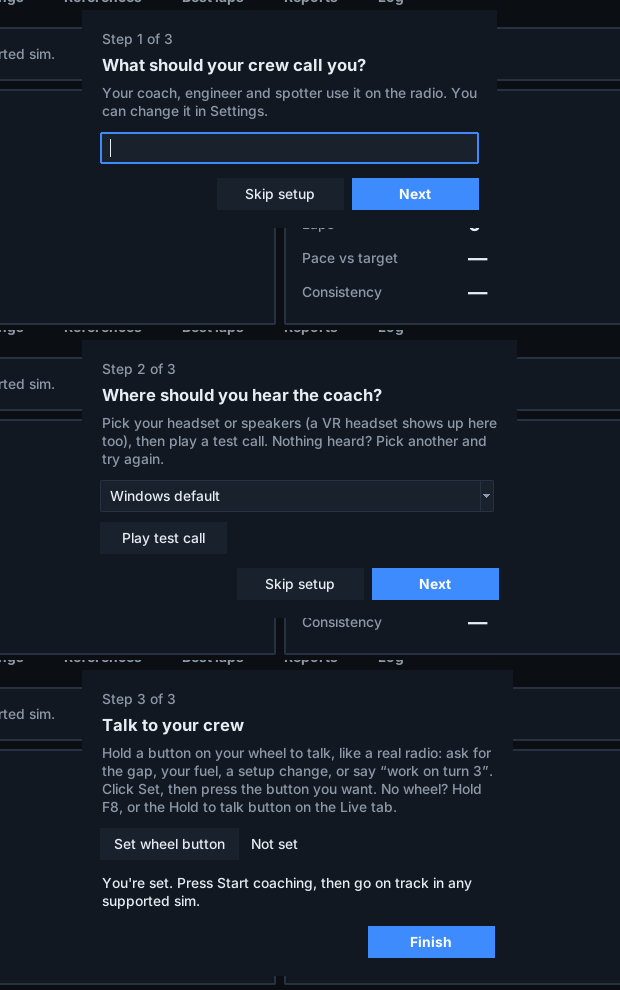
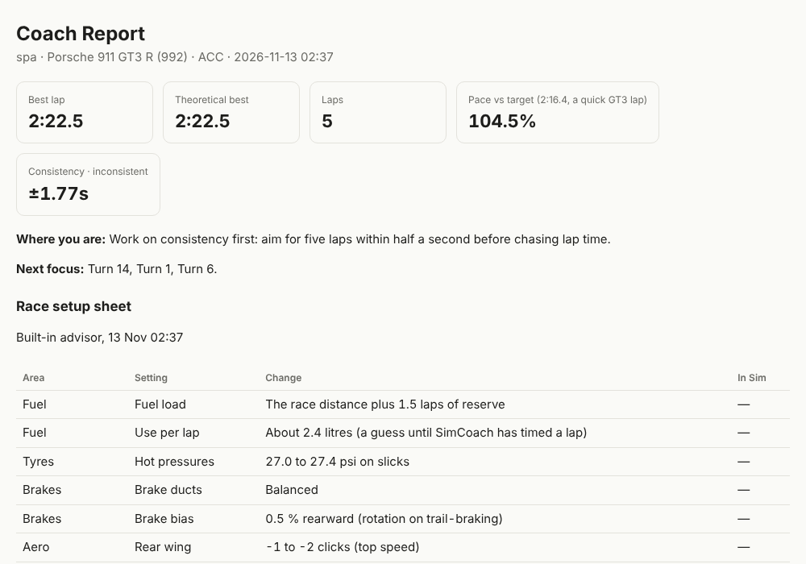

# SimCoach: a live voice coach for sim racing (Windows 10/11)

**Drive. Hear where the time is. Fix one corner at a time. Come back quicker next session.**

SimCoach listens to your sim's telemetry and coaches you over the radio as you drive: braking tones before the
corners that matter, a diagnosis as you exit them, one thing to work on after each lap, and a written report
when you stop. Then it carries your weakest corner into the next session as a goal and tells you when you've
fixed it.

* **[Download SimCoach-Setup.exe (Windows Installer, v6.19)](SimCoach-Setup.exe)**: free, no admin rights needed
* **[Latest release & full ZIP](../../releases/latest)**
* **[▶️ Watch the preview video (1080p MP4)](simcoach_preview.mp4)**

## Get going in three steps
1. **Install:** run `SimCoach-Setup.exe`. It installs Python, SimCoach's packages and free offline speech
   recognition. If Windows SmartScreen appears: *More info → Run anyway*.
2. **Quick setup** (opens by itself the first time): your name, where the coach's voice plays, and the wheel
   button you hold to talk (F8 works too).
3. **Drive.** Coaching starts on its own and waits for your sim. At 55 well-known circuits it coaches from
   lap one; anywhere else, your first clean lap maps the corners and coaching starts on the next.

## How it coaches you
| When | What you get |
|---|---|
| **Before you start** | The target: what a quick lap is for your sim and class (87 benchmark times at 48 tracks), and **today's goal**: the corner that cost you most last session. |
| **On the approach** | Three braking tones timed to your reference lap's braking point at your focus corners. |
| **On the exit** | What went wrong, in plain words: *"Turn 5, 3 tenths lost. You braked 15 metres early."* |
| **After each lap** | Lap time, gap to your best and **one** coaching point for the next lap. Laps spoiled by traffic, a yellow or cold tyres aren't held against you. |
| **When you stop** | An HTML Coach Report: speed trace, turn-by-turn losses, pace against the target, consistency, and progress across sessions. Add an AI key and it also gets a written analysis and practice plan. |
| **Next session** | Your worst corners come back as the goal, tracked lap by lap on the Live tab, with a *"Goal done"* call once you've fixed them. |

Ask it things over the radio: *"what's my goal?"*, *"what's the target time?"*, *"how consistent am I?"*,
*"work on turn 3 for five laps"*, *"be quiet"*. The full list is in [README.txt](README.txt).

## Simple by default
A new install opens in **Simple view**: the Live, Laps & corners, Settings and Reports tabs and the everyday
settings. **Show everything** (top right) brings in the rest: radio check, reference and best-lap libraries,
the log and data capture, and every advanced setting. Nothing is switched off while it's hidden.

## Supported sims
Assetto Corsa, ACC, AC EVO, AC Rally, Le Mans Ultimate, rFactor 2, Automobilista 2 (*Shared Memory = Project
CARS 2*), RaceRoom, iRacing, F1 25 (*UDP 20777, format 2025*), EA WRC and DiRT Rally 2.0. Shares port 20777
with SimHub.

## Everything else it does
* **Race crew:** an engineer, strategist and spotter call fuel, energy, temperatures, wear, track limits,
  weather, flags, gaps and cars alongside. Urgent calls cut in ahead of everything else.
* **Race starts and drills:** a grid reminder and a start review after turn one; focused corner drills on
  request.
* **Setup help:** a setup briefing and a click-to-apply setup sheet at the start of each session (it shows
  every change and asks first).
* **Shared reference library:** laps other drivers share are downloaded for your exact sim, track and car;
  share your own best laps in one click (free GitHub sign-in).
* **Overlay and phone screen:** a click-through overlay with delta and pedal traces, and a live page for a
  phone or tablet on the same Wi-Fi.
* **Talk to it:** push-to-talk with offline speech recognition; optional AI answers, banter, setup briefings
  and commands in your own words through OpenAI, Google Gemini or DeepSeek, with automatic fallback.
* **Works with [SimCast](https://github.com/Jcedwar61/SimCast):** its TV commentary drops under the coach and
  crew while they talk.

The full guide is in [README.txt](README.txt), every release's changes in [CHANGELOG.md](CHANGELOG.md), the
library's rules in [references/](references/), developer tools and the release checklist in [tools/](tools/),
and third-party data credits in [THIRD_PARTY_NOTICES.md](THIRD_PARTY_NOTICES.md).

### What's new in 6.19
* **A refined look:** the SimCoach window has been redesigned. Buttons, text boxes, drop-downs, cards,
  check boxes, sliders and scroll bars are now smooth and rounded; the tabs are clean labels with an
  underline on the one you're in; the top bar is calmer, with *Start coaching* standing out as the one main
  action; tables are roomier; and the Live tab lists your lap stats in a tidy column.
* **Welcome box:** the first-run quick setup opens in the middle of the window and takes the keyboard, so you
  can type your name straight away.

### What's new in 6.18
* **Session goals:** when a session ends, the one or two corners that cost you the most time per clean lap
  become the goal for your next session with that car and track. The coach names the goal in its opening
  call, makes those corners your first focus corners, shows how each is going against last session on the
  Live tab, and says *"Goal done"* once you're quicker there over three clean laps. The Coach Report has a
  *Goal from last session* table, the AI analysis sees it, and you can ask *"what's my goal?"*.
* **Simple view:** new installs show only the coaching essentials (four tabs and the everyday settings);
  *Show everything* brings back every tab and setting. Copies updated from an earlier version keep showing
  everything until you click *Simple view*.
* **A shorter README:** the release history has moved to [CHANGELOG.md](CHANGELOG.md).
