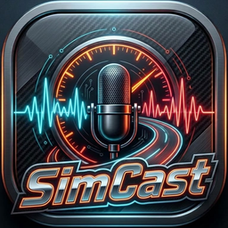

<p align="center"></p>

# SimCast: live TV commentary for your sim race

SimCast gives your sim race the television treatment. While you drive, a commentary booth calls the **whole
race** live in your headphones: the start, overtakes anywhere in the field, battles building up, pit stops,
fastest laps, cars in trouble, the final lap and the finish. It also follows your own race, the way a broadcast
follows a driver in the story.

It is built on SimCoach's foundation (the same sim readers, AI providers and settings), and it can run
alongside SimCoach.

### The booth
* **Ben, the lead commentator**, calls the action: *"And Okafor takes the lead! Past Moretti, and into first place!"*
* **Kate, the analyst**, explains it: *"That's been coming. Okafor has looked the quicker of the two."*
* **Mia, the pit-lane reporter**, brings you every stop: *"Moretti is back out, in fifth, thirty-one seconds in the pit lane."*

Names and voices can be changed. Each speaks in their own voice, and gets faster, higher and louder as the
moment gets bigger. When something big happens, the lead cuts in over whatever's being said, the way it does on TV.

### How it decides what to say
* **The race model** watches every car through 40 virtual timing loops a lap, just like a TV timing system. The
  gap between two cars is measured where they both crossed the same loop. From that it finds the moments worth
  talking about: on-track passes (not position changes in the pits, around a stopped car or through lapped
  traffic), battles that have lasted, a chaser closing in, the leader pulling away, pit stops in and out, the
  fastest lap, a car stopped on track, a spin (time suddenly lost over a few corners), retirements, cautions,
  laps to go, the final lap, the winner, the podium and your finish.
* **The director** decides what goes on air: the biggest fresh story goes next, stale ones are dropped, and huge
  ones cut in. In quiet spells it talks about the race: the running order, a battle elsewhere, who's quickest,
  who has still to stop, your own race, and drivers who haven't had a mention, so the whole grid gets airtime.
* **Instant lines** call every moment the moment it happens, with no network round-trip and no repeats.
* **AI colour (optional)**: with an OpenAI, Gemini or DeepSeek key (from SimCoach's settings, or added in
  SimCast), the analyst reacts to big moments with real analysis, quiet spells become proper back-and-forth
  between the two, and there's a proper sign-off at the end. The AI gets the live standings, gaps, lap times,
  battles, recent events and what the booth just said, with strict rules: only facts from the data, nothing
  invented, no repeats, drivers by name. If it's slow or down, the booth carries on without it.

## Start
1. Run **SimCast.bat** (first launch downloads its parts). The control page opens in your browser.
2. Click **Start a demo race** to hear it straight away, without a sim.
3. Start a race in your sim. SimCast goes live by itself.

Voices: the free Microsoft neural voices by default; **OpenAI voices** (Settings → Voices) are the most lifelike,
because each line is spoken with its own direction (*"excited, voice rising"*) using your OpenAI key.

### Sims
| Sim | Whole field | Notes |
| --- | --- | --- |
| Le Mans Ultimate, rFactor 2 | ✔ | positions, laps, lap times, pit stops, classes, finish status |
| iRacing | ✔ | positions, laps, lap times, pit road |
| Automobilista 2 | ✔ | *Shared Memory = Project CARS 2* |
| RaceRoom | ✔ | |
| F1 25 | ✔ | plus the game's own events: collisions, penalties, safety car |
| Assetto Corsa | ✔ | needs the **CrewChiefEx** app on (Content Manager → Settings → Assetto Corsa → Python apps) |
| ACC | ✖ for now | ACC only shares other cars' positions through its broadcasting API, not yet supported |
| Rally games | ✖ | one car on a stage: nothing to commentate on |

Qualifying and practice get lighter commentary: provisional pole, improvements, and your lap.

### Settings (on the control page)
* **How chatty**: Quiet, Normal or Chatty (how soon a quiet spell gets filled).
* **Follow**: *Whole field* (a neutral broadcast), *Balanced* (default: your race is one of the stories), or *Mostly me*.
* **Your name**, as the booth should say it (otherwise your sim name).
* Booth names, voices (with a **Test** button each), pit reporter on or off, volume.
* **AI colour**: on or off, provider, keys. Keys are stored only on your PC and never shown back on the page.

### For streamers
Add `http://127.0.0.1:8766/overlay` as a **Browser source** in OBS: a TV timing tower and live captions of what
the booth is saying, on a transparent background. Options: `?rows=10`, `?tower=0` (captions only), `?captions=0`.

### Phone or tablet
Set `"lan": true` in `%APPDATA%\SimCast\config.json` to open the page from other devices on your network
(they can watch; only this PC can change settings).

## For developers
```
sim_cast.py              entry point (--demo, --test, --no-voice, --no-browser, --port)
simcast/race.py          the race model: timing loops, gaps, and the moments (Events)
simcast/director.py      what goes on air, when, and what gets cut off
simcast/writer.py        the instant lines for each kind of moment, in three voices
simcast/ai.py            the AI booth: race brief, rules, reactions, conversation, sign-off
simcast/audio.py         speech: edge-tts or OpenAI voices, pre-synthesis, interruptions (SimAudio for tests)
simcast/demo.py          a fictional 12-car race for the demo and the tests
simcast/web.py, ui/      the control page and the overlay
```
The sims' whole field comes from SimCoach's readers: `Frame.field` (one `field_entry()` per car) and, for
F1, `Frame.sim_events`.

`python sim_cast.py --test` runs a whole demo race silently on a fast clock and prints the commentary.
`tools/tests/test_simcast.py` covers the race model, the booth, the AI booth (with a stand-in model), the
page's API and the readers' field data. `tools/run_tests.sh` runs it with SimCoach's tests.
