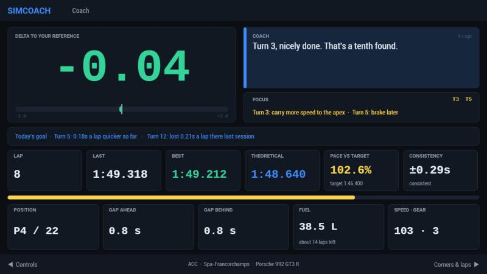
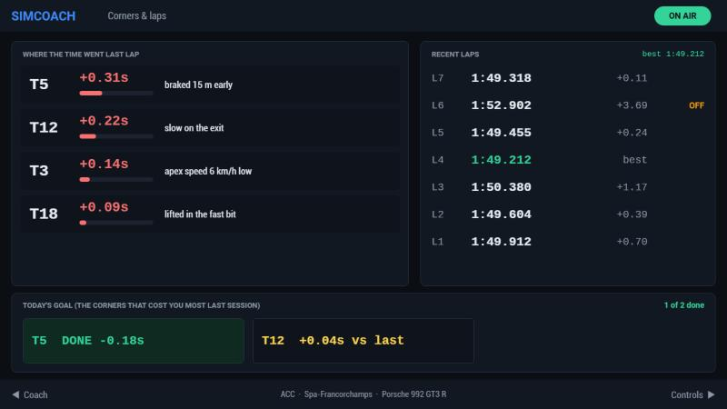
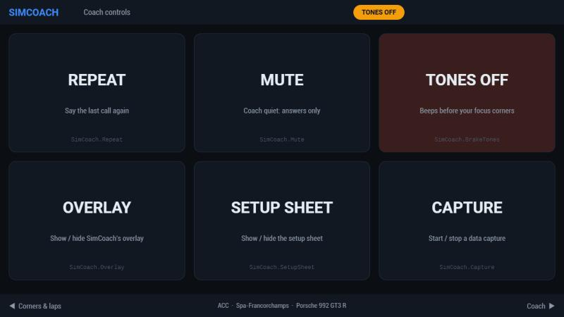

# SimCoach for SimHub

Put SimCoach's coaching on any SimHub screen: a wheel display, a tablet, a phone, a second monitor or an
in-game overlay. A small SimHub plugin receives SimCoach's live feed and turns it into `SimCoach.*` properties;
the **SimCoach dashboard** uses them all, and its touch buttons (or any wheel/button-box button mapped in SimHub)
control the coach.



| Corners & laps | Controls |
|---|---|
|  |  |

## Install (once)

1. SimCoach 6.22 or later. *Send coaching to SimHub dashboards* is on by default (Settings; it's one of the
   settings *Show everything* shows).
2. Run, from this folder:
   ```powershell
   powershell -ExecutionPolicy Bypass -File simhub\install.ps1 -Restart
   ```
   It finds SimHub, copies `SimCoach.SimHub.dll` into it and the dashboard into `DashTemplates\SimCoach`.
   `-Restart` closes and restarts SimHub; if SimHub runs as administrator, exit it from its tray icon and start
   it again yourself.
3. When SimHub starts, say **yes** if it asks to enable the new *SimCoach* plugin. *SimCoach* then appears in
   SimHub's left menu, saying *Connected to SimCoach …* once SimCoach is open.
4. **Dash Studio → SimCoach → Play**, or pick *SimCoach* for your device, or open it on a phone or tablet
   from SimHub's web page (`http://<this PC>:8888`).

Preview it without driving: close SimCoach and run `python simhub\demo_feed.py`.

## The dashboard (1280 × 720, scales to any screen)

| Screen | What's on it |
|---|---|
| **Waiting** (idle) | Whether SimCoach is open and coaching, today's goal, your best and the target lap. |
| **Coach** | Big delta to your reference with a gain/loss bar · the coach's last call, lit up while it's new · focus corners (or the drill you asked for) · today's goal, or what the coach just heard you say · lap, last, best, theoretical best · pace against the target (% and a bar) · consistency · position, gaps, fuel and laps left, speed and gear · ON AIR / LISTENING / MUTED / TONES OFF / OFFLINE lights. |
| **Corners & laps** | Where the time went last lap (worst five corners with what went wrong) · the last eight laps against your best · goal corners from last session and how they're going. |
| **Controls** | Big touch buttons: Repeat, Mute, Braking tones, Overlay, Setup sheet, Capture. |

Tap the bottom-left or bottom-right of a screen to change screen.

## Buttons on your wheel

SimHub → *Controls and events* → add a mapping to any of these:

| Action | Does |
|---|---|
| `SimCoach.Repeat` | Says the last call again |
| `SimCoach.Mute` | Mutes / unmutes the coach (answers still come through) |
| `SimCoach.BrakeTones` | Braking tones on / off |
| `SimCoach.Overlay` | Shows / hides SimCoach's overlay |
| `SimCoach.SetupSheet` | Shows / hides the setup sheet |
| `SimCoach.Capture` | Starts / stops a data capture |
| `SimCoach.PushToTalk` (input) | Hold to talk to the coach |

Handy when the button is on a device SimHub reads but SimCoach doesn't (some button boxes, Stream Decks).

## Properties, for your own dashboards

Search for `SimCoach` in Dash Studio's property picker. The main ones:

| Property | |
|---|---|
| `Connected`, `Running`, `Live` | SimCoach is open · coaching is started · a sim is sending telemetry |
| `Delta`, `DeltaText`, `DeltaValid` | seconds to your reference (negative = quicker) |
| `Coach`, `CoachAge`, `CoachFresh` | the coach's last call, seconds since, and true for 8 s after a new one |
| `Focus`, `FocusTurns`, `Drill`, `Goal`, `Heard`, `HeardFresh` | coaching focus, drill, today's goal, what it heard you say |
| `Talking`, `Listening`, `Muted`, `BrakeTones`, `BrakeTonesOn`, `Mic` | radio state |
| `Lap`, `LapsDone`, `LastLap`, `BestLap`, `TheoreticalBest`, `TargetLap` (+ `…Seconds`) | lap times |
| `PacePercent`, `Consistency`, `ConsistencyLabel` | pace against the target, lap-time spread |
| `Position`, `Cars`, `GapAhead`, `GapBehind`, `Fuel`, `FuelLaps`, `Speed`, `Gear` | race |
| `Worst1…5.Turn/.Loss/.Issue`, `WorstCount` | where the time went last lap, biggest loss first |
| `Corner01…30.Loss/.Issue`, `CornerCount` | every corner by turn number |
| `Laps1…8.Number/.Time/.Seconds/.Gap/.Flag`, `LapCount` | recent laps, newest first |
| `Goals1…3.Turn/.Change/.Laps/.Done/.Text`, `GoalCount`, `GoalsDone` | goal corners from last session |

Events (for LED effects, ShakeIt and sounds): `SimCoach.CoachLine`, `SimCoach.NewBestLap`, `SimCoach.GoalDone`,
`SimCoach.Connected`, `SimCoach.Disconnected`.

## For developers

* `plugin/SimCoachPlugin.cs`: the plugin. `build_plugin.ps1` compiles it with the C# compiler built into Windows
  against your SimHub's own DLLs (no Visual Studio); the result is `SimCoach.SimHub.dll`.
* `make_dashboard.py`: writes `dashboard/SimCoach/`. Change the dashboard there and regenerate, or edit it
  in Dash Studio.
* `demo_feed.py`: a made-up session for designing without a sim.
* The wire format between SimCoach and the plugin: [docs/simhub-link.md](../docs/simhub-link.md).
